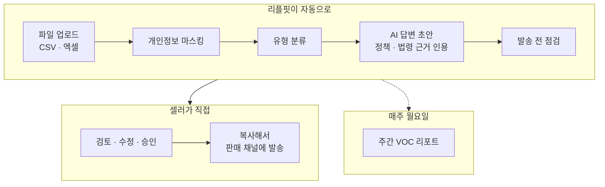
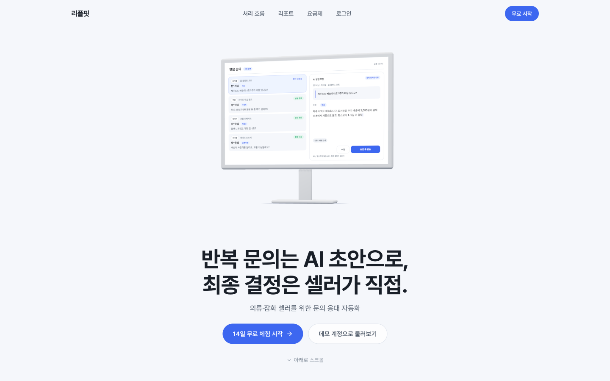
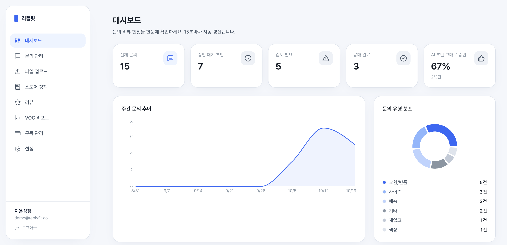
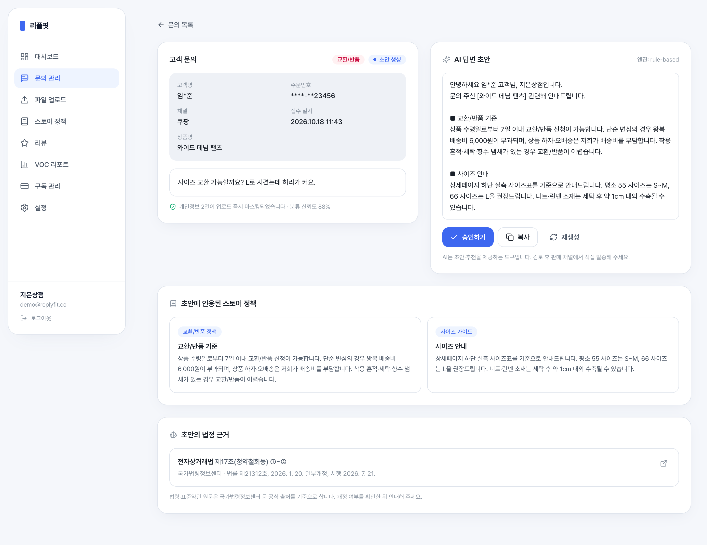
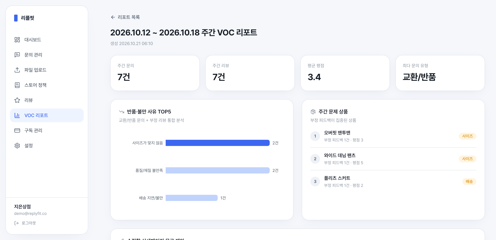
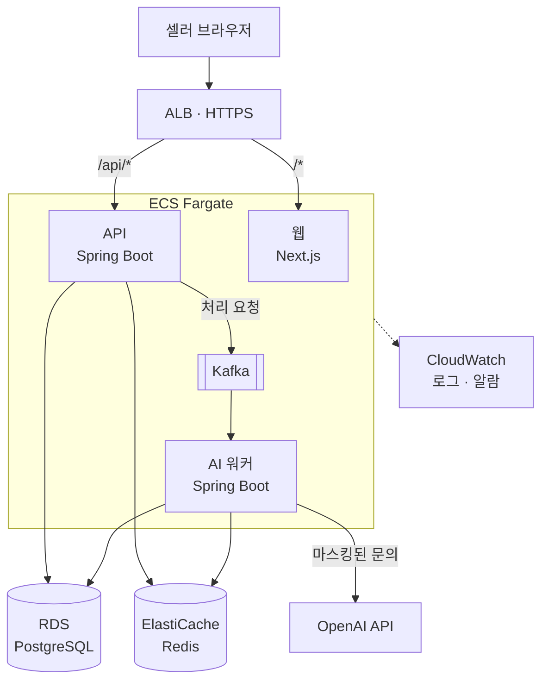

# 리플핏 ReplyFit

**반복 문의는 AI 초안으로, 최종 결정은 셀러가 직접.**

의류·잡화 온라인 셀러를 위한 문의 응대 자동화 B2B SaaS

AWS 베타 준비 중 · MVP 정식 출시 목표 2026년 11월

---

의류·잡화 쇼핑몰에는 사이즈·배송·교환/반품·재입고처럼 비슷한 문의가 매일 되풀이되고, 셀러는 그때마다 정책을 찾아 비슷한 답을 다시 씁니다.
그렇다고 AI에게 그대로 맡기면 정책에 없는 약속, 틀린 법률 안내, 고객 개인정보 노출이라는 새로운 위험이 생깁니다.

리플핏은 판매 채널의 문의·리뷰를 파일로 올리면 **개인정보부터 가리고**, 문의마다 셀러가 등록한 정책과 공개 법령을 **근거로 인용한 답변 초안**을 만든 뒤, **셀러가 검토·승인해 직접** 보내게 합니다.
쌓인 문의와 리뷰는 매주 VOC 리포트로 묶어 반품 원인과 고칠 상품 문구를 짚어 줍니다.

## 어떻게 동작하나요

- 문의 1건이 처리 요청 1건으로 비동기 처리되고, 업로드 화면에서 진행률을 실시간으로 봅니다.
- OpenAI 호출이 실패하거나 키가 없어도 규칙 기반 엔진으로 넘어가 흐름이 멈추지 않습니다.

## 주요 기능

- **파일 업로드** — CSV와 엑셀(.xlsx)을 그대로 올립니다. 네이버 스마트스토어에서 내려받은 리뷰 엑셀은 열 이름을 고치지 않고 올릴 수 있고, 윈도우 엑셀로 저장한 CSV(CP949)나 구매자명·제품명·별점처럼 이름이 조금 다른 열도 알아서 읽습니다. 이미 올린 문의는 건너뛰고, 올리기 전에 마스킹 결과를 미리 봅니다.
- **유형 분류** — 사이즈·배송·교환/반품·색상·재입고·기타 6가지로 나누고 반품 사유·이슈 태그를 붙입니다.
- **근거가 붙은 답변 초안** — 셀러가 등록한 스토어 정책(배송·교환/반품·사이즈 가이드·재입고·일반 안내)과 공개 법령·표준약관 조문을 찾아 인용합니다. 말투는 셀러가 고쳐서 승인한 최근 답변을 따릅니다.
- **발송 전 점검** — 정책·인용 조문·문의 원문 어디에도 없는 수치(N일·N%·N원), 관련 정책이 없어 남은 임시 문구, 분류가 불확실한 문의, 환불·보상·분쟁 표현을 찾으면 '검토 필요'로 돌리고 사유를 한 줄씩 보여 줍니다.
- **검토·승인** — 초안 수정 → 승인 → 복사해 판매 채널에 붙여 넣기 → 발송 완료 표시. 마음에 들지 않으면 다시 생성합니다.
- **대시보드** — 처리 현황, AI 초안을 고치지 않고 승인한 비율, 주간 문의 추이, 유형 분포를 15초마다 갱신합니다.
- **리뷰 분석** — 평점과 본문으로 긍정·중립·부정을 가르고 이슈 키워드를 뽑습니다.
- **주간 VOC 리포트** — 반품·불만 사유 TOP5와 문제 상품을 보여 주고, 고칠 상세페이지 문구를 제안합니다. 매주 월요일 지난주 리포트를 자동으로 만듭니다.
- **계정·요금제** — 14일 무료 체험, 플랜별 월 처리량, 베타 기간 초대 코드 가입. 탈퇴하면 셀러 데이터를 바로 지웁니다.

## 화면

<table>
  <tr>
    <td align="center" valign="top" width="50%">
       
      <b>랜딩</b> — 문의가 답변과 리포트가 되는 과정을 스크롤로 보여 줍니다
    </td>
    <td align="center" valign="top" width="50%">
       
      <b>대시보드</b> — 처리 현황 · AI 초안 그대로 승인한 비율 · 주간 추이 · 유형 분포
    </td>
  </tr>
  <tr>
    <td align="center" valign="top" width="50%">
       
      <b>문의 상세</b> — 마스킹된 고객 정보, AI 초안과 인용한 정책 · 법정 근거
    </td>
    <td align="center" valign="top" width="50%">
       
      <b>주간 VOC 리포트</b> — 반품·불만 사유 TOP5 · 문제 상품 · 문구 제안
    </td>
  </tr>
</table>

## 원칙

- **AI는 직접 발송하지 않습니다** — AI는 초안과 추천까지만 맡습니다. 셀러가 검토·승인한 답을 셀러가 직접 판매 채널에 올리는 구조로, 오답·개인정보·플랫폼 약관 위험을 설계 단계에서 막습니다.
- **등록된 정책과 공개 법령만 인용합니다** — 근거는 셀러가 등록한 정책과 국가법령정보센터·공정거래위원회에 공개된 법령·표준약관 원문뿐입니다. 출처 없는 수치가 보이면 정책 검증 로직(PolicyGuard)이 초안을 '검토 필요'로 돌립니다.
- **개인정보는 최소한으로 다룹니다** — 업로드 즉시 고객 이름·주문번호·이메일·주소·전화번호·계좌번호를 가리고 원문은 저장하지 않습니다. 분류·초안 작성을 위해 OpenAI(미국)로 보내는 고객 문의도 마스킹한 뒤의 내용뿐이며, 보관 기간(기본 180일)이 지나면 매일 자동으로 삭제합니다. 셀러의 고객 데이터는 광고나 자체 AI 모델 학습에 쓰지 않습니다.

## 아키텍처

운영 환경은 AWS 서울 리전을 대상으로 Terraform 코드로 정의해 두었고, 첫 배포를 준비하고 있습니다.

- **API와 워커는 같은 이미지**를 프로필만 바꿔 띄웁니다. 업로드는 문의를 DB에 먼저 저장한 뒤 Kafka로 처리 요청을 보내고, 일시적인 장애는 재시도한 뒤 DLT로 옮깁니다. 접수 상태로 남은 문의는 스위퍼가 다시 보냅니다.
- **Redis**는 로그인 토큰 회전·요청 제한·업로드 진행률·대시보드 캐시를 맡습니다.
- **법령 근거 검색**은 법령·표준약관을 조문 단위로 나눠 두고 임베딩 유사도로 고릅니다. 임베딩이 없으면 어휘 점수로 찾고, 규칙 기반 폴백도 검색된 조문을 인용합니다.
- **알람**도 코드에 있습니다. 5xx 비율, 서비스별 CPU·메모리·실행 중인 태스크 수, RDS·Redis 지표, LLM 하루 비용(추정), DLT 적재를 CloudWatch로 보고 메일로 알립니다.
- **로컬**에서는 Docker Compose 한 번으로 전체 스택을 띄우고, 필요할 때 Prometheus·Grafana·k6 부하 테스트를 붙입니다. 에러 추적(Sentry)은 DSN을 넣을 때만 켜집니다.

## 기술 스택

<table>
  <tr><th nowrap>영역</th><th>사용 기술</th></tr>
  <tr><td nowrap>프론트엔드</td><td>Next.js 15 (App Router) · React 19 · TypeScript · Tailwind CSS v4 · SWR · Recharts · framer-motion · React Three Fiber</td></tr>
  <tr><td nowrap>백엔드</td><td>Java 21 · Spring Boot 3.5 · Spring Security (JWT) · Spring Data JPA · Flyway · ShedLock · springdoc-openapi</td></tr>
  <tr><td nowrap>데이터·메시징</td><td>PostgreSQL 16 · Redis 7 · Apache Kafka (KRaft)</td></tr>
  <tr><td nowrap>AI</td><td>OpenAI API (기본 gpt-5-mini · Structured Outputs) · text-embedding-3-small 임베딩 + 어휘 점수 검색 · 규칙 기반 폴백 엔진</td></tr>
  <tr><td nowrap>인프라</td><td>AWS ECS Fargate · ALB · RDS · ElastiCache · EFS · ECR · Secrets Manager · CloudWatch · SNS · Terraform · Docker Compose · Kubernetes (로컬 실험용)</td></tr>
  <tr><td nowrap>품질·관측</td><td>JUnit · Testcontainers · Vitest · ESLint · Trivy · Dependabot · Prometheus · Grafana · k6 · Sentry (선택)</td></tr>
</table>

## 저장소

<table>
  <tr><th nowrap>저장소</th><th>하는 일</th></tr>
  <tr><td nowrap><a href="https://github.com/ReplyFit/replyfit-backend">replyfit-backend</a></td><td>REST API와 Kafka 워커 — 업로드·마스킹, AI 분류·초안·발송 전 점검, 법령 근거 검색, VOC 리포트, 보관 기간 삭제</td></tr>
  <tr><td nowrap><a href="https://github.com/ReplyFit/replyfit-frontend">replyfit-frontend</a></td><td>랜딩과 셀러 웹앱 — 대시보드·문의 검토·업로드·정책·리뷰·리포트·요금제·계정 설정, 약관·개인정보 처리방침</td></tr>
  <tr><td nowrap><a href="https://github.com/ReplyFit/replyfit-infra">replyfit-infra</a></td><td>전체 스택 Docker Compose, AWS Terraform·배포 가이드, Kubernetes 매니페스트, 모니터링·부하 테스트, 샘플 데이터</td></tr>
</table>

> 세 저장소는 비공개입니다. 위 링크는 팀원만 열 수 있습니다.

## 개발 방식

- **이슈 먼저** — 모든 작업은 이슈(버그·기능·작업 템플릿)에 범위와 할 일을 적고 시작하며, 우선순위와 마일스톤을 붙입니다.
- **브랜치와 PR** — `feat/*`·`fix/*` 등에서 작업해 `develop`으로 PR을 올리고, 리뷰와 CI 통과 뒤 merge commit으로 합칩니다. 마일스톤 단위로 `develop`을 `main`에 릴리즈합니다.
- **커밋** — Conventional Commits에 한국어 제목, 기능 단위로 나누고 한 커밋은 1,000줄을 넘기지 않습니다.
- **CI (모든 PR)** — 백엔드 Gradle 빌드·테스트(Testcontainers PostgreSQL), 프론트 ESLint·Vitest·프로덕션 빌드(백엔드 OpenAPI 명세로 만든 타입과 대조), 인프라 Compose·Kubernetes(kubeconform)·Terraform(fmt·validate) 검증.
- **배포 (`v*` 태그에서만)** — 이미지 Trivy 취약점 스캔 → GitHub OIDC로 AWS 인증 → ECR(덮어쓸 수 없는 태그) → ECS 롤링 배포. 되돌릴 때는 이전 태그를 재배포 워크플로로 다시 띄웁니다.
- **의존성** — Dependabot이 라이브러리·GitHub Actions·Terraform 프로바이더 업데이트를 매주 올립니다.

## 현재 상태와 로드맵

<table>
  <tr><th nowrap>단계</th><th nowrap>상태</th><th>내용</th></tr>
  <tr><td nowrap>MVP 핵심 기능</td><td nowrap>완료</td><td>업로드 → 마스킹 → 분류 → 근거 인용 초안 → 발송 전 점검 → 승인 → 주간 VOC 리포트, 계정·무료 체험, 베타 지표 수집</td></tr>
  <tr><td nowrap>AWS 배포 준비 (v0.2.0)</td><td nowrap>코드 완료</td><td>운영 인프라 코드(Terraform)·CI/CD·알람·배포 가이드, 이용약관·개인정보 처리방침 초안</td></tr>
  <tr><td nowrap>AWS 베타</td><td nowrap>다음 단계</td><td>서울 리전 첫 배포, 약관 확정, 초대 코드로 베타 셀러 온보딩, 무수정 승인율·승인까지 걸린 시간 측정</td></tr>
  <tr><td nowrap>MVP 정식 출시</td><td nowrap>2026년 11월 목표</td><td>상품 사이즈표를 등록하면 사이즈 문의에 실측값으로 답하기, 베타 문의로 만든 AI 평가 세트로 분류 정확도 측정</td></tr>
  <tr><td nowrap>그 이후</td><td nowrap>계획</td><td>정기결제(토스페이먼츠), 마켓 연동(네이버 커머스API 상품 Q&amp;A 등), 매장 단위 다중 사용자</td></tr>
</table>

## 팀

최용주 (기획/풀스택) · 기승현 (기획/PM) · 권성호 (백엔드/고객검증) — 2026 SW중심대학 AI/SW 창업 프로젝트
